<div align="center">


### Finanzas personales y familiares para Panamá — en balboas y dólares

*Ingresos, salarios quincenales, gastos, cuentas, presupuestos, ahorros y deudas bajo control desde un único lugar. Sin nube: tus datos se quedan en tu equipo.*

[](https://github.com/eperez98/monto/actions/workflows/ci.yml)


</div>

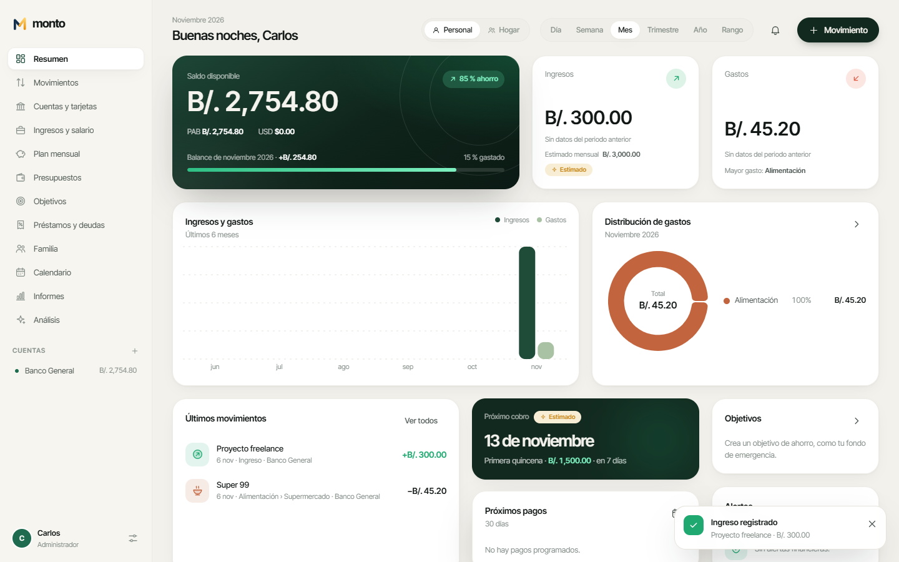

## Contenido

- [Características](#características)
- [Capturas de pantalla](#capturas-de-pantalla)
- [Descargar](#descargar)
- [Tecnologías](#tecnologías)
- [Requisitos](#requisitos)
- [Instalación para desarrollo](#instalación-para-desarrollo)
- [Configuración](#configuración)
- [Compilación](#compilación)
- [Guía de uso](#guía-de-uso)
- [Pruebas](#pruebas)
- [Estructura del proyecto](#estructura-del-proyecto)
- [Contribuir](#contribuir)
- [Licencia](#licencia)

## Características

**Hecho para Panamá**
- Balboa (**PAB**, `B/.`) y Dólar (**USD**, `$`) con paridad 1:1. Cada cuenta conserva su moneda y los totales se muestran por separado y combinados.
- Salario **quincenal** con primera y segunda quincena independientes, días de pago configurables (15 y 30 / último día), adelanto automático cuando el pago cae en fin de semana.
- Descuentos de ley opcionales (**CSS 9,75 %**, **Seguro Educativo 1,25 %**) y **décimo tercer mes** estimado (15 de abril, agosto y diciembre).
- Métodos de pago locales (ACH, **Yappy**, efectivo, tarjetas) y categorías como *Peajes (Panapass)*.

**Ingresos y salarios**
- Semanal, bisemanal, quincenal, mensual, por horas, variable/freelance u otros.
- Cálculo automático de ingreso por pago, mensual, anual, promedio real, próxima fecha de pago y total recibido en el año. Ejemplo: B/. 1,500 por quincena → B/. 3,000 al mes → B/. 36,000 al año.
- **Estimado ≠ recibido**: ningún pago se marca como recibido antes de su fecha ni sin tu confirmación.

**Finanzas del día a día**
- Movimientos: ingresos, gastos, transferencias, pagos de tarjeta, préstamos recibidos, abonos y reembolsos, con categoría, cuenta, método de pago, notas, responsable y **comprobantes adjuntos**.
- Búsqueda, filtros, edición, eliminación, importación CSV y exportación.
- Cuentas de ahorro, corrientes, efectivo, tarjetas de crédito (con límite y uso) y débito, inversiones.
- Categorías y **subcategorías** personalizables.

**Planificación**
- **Presupuestos** mensuales por categoría con alertas al 70 %, 90 % y 100 %.
- **Objetivos** de ahorro (emergencia, vehículo, vivienda, vacaciones, educación…) con anillo de progreso animado y celebración al completarlos.
- **Préstamos y deudas** (personales, hipotecas, auto, tarjetas, deudas entre personas) con cuota, intereses, saldo pendiente y tabla de **amortización**.
- **Calendario financiero** con cobros, cuotas, pagos recurrentes y recordatorios.

**Familia**
- Perfil individual, en pareja o familiar con integrantes, avatares y roles (**Administrador, Adulto, Miembro, Solo lectura**) aplicados también en la capa de datos.
- Vista **Personal / Hogar** con separación clara, gastos compartidos repartidos, distribución de responsabilidades, **deudas entre integrantes** con liquidación y historial del hogar.

**Inteligencia basada en tus datos**
- Pagos recurrentes (con registro automático solo en fecha), detección de **gastos duplicados**, alertas, recordatorios, resumen mensual, comparación de hábitos, categorías con gasto elevado y proyecciones de ahorro. Las estimaciones siempre se etiquetan como tales.

**Informes**
- Ingresos, gastos, flujo de efectivo, ahorros, deudas, gastos por categoría, evolución mensual y comparación anual. Exportación a **Excel (.xlsx)**, **CSV** y **PDF**.

**Privacidad y seguridad**
- 100 % local y **sin conexión**. Ningún dato financiero sale del equipo; la única conexión opcional es la búsqueda de actualizaciones.
- Contraseña opcional con cifrado **AES-256-GCM** de toda la base de datos, **bloqueo automático** por inactividad (y `Ctrl + L`), PIN por integrante y registro de sesiones.
- Copias de seguridad automáticas diarias, manuales, exportación/importación (`.monto`, JSON) y verificación de integridad SQLite.

**Actualizaciones**
- *Configuración → Actualizaciones*: busca nuevas versiones (estables o Beta) en GitHub Releases, muestra las notas, descarga el paquete, **verifica su SHA-256**, crea una copia de seguridad y actualiza conservando tus datos. La búsqueda automática es opcional.

**Idiomas**
- Interfaz completa en **español** e **inglés**. La primera vez se usa el idioma de Windows; puedes cambiarlo en la configuración inicial o en *Configuración → Apariencia*.
- El instalador pregunta el idioma (español o inglés).

**Experiencia**
- Splash animado, configuración inicial guiada, modo claro/oscuro automático según Windows, transiciones, contadores animados, gráficos que se dibujan progresivamente, notificaciones internas y soporte para **reducir el movimiento**.

## Capturas de pantalla

| | |
|---|---|
| 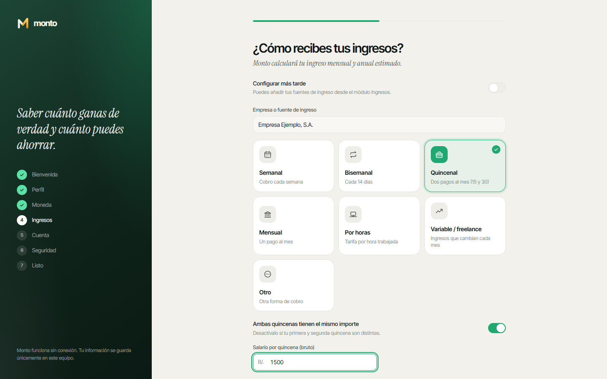 Configuración guiada del salario | 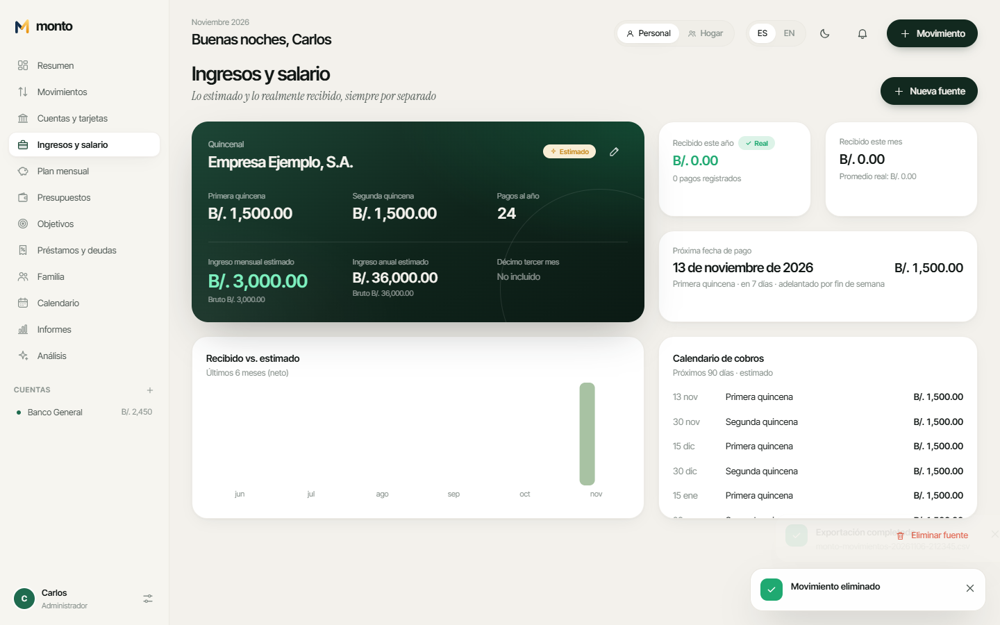 Ingresos: estimado vs. recibido |
| 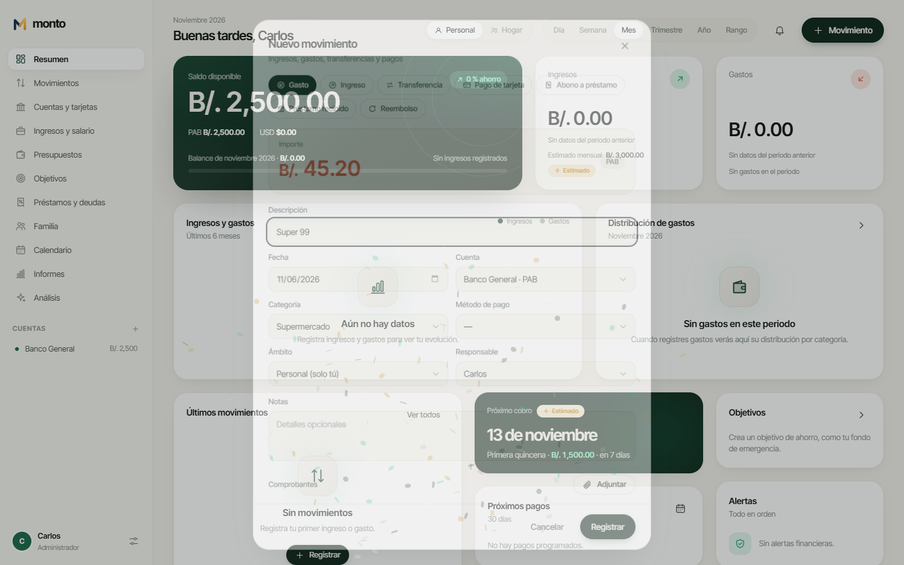 Registro de movimientos | 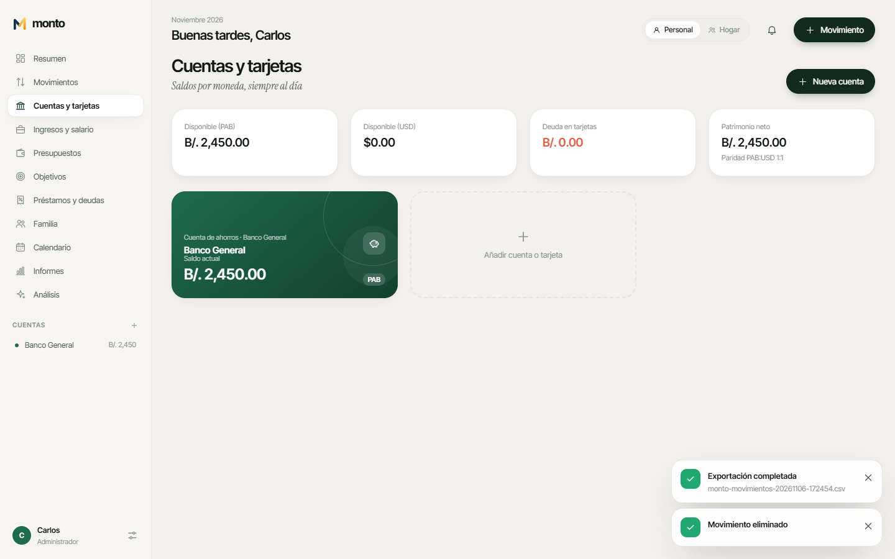 Cuentas y tarjetas |
| 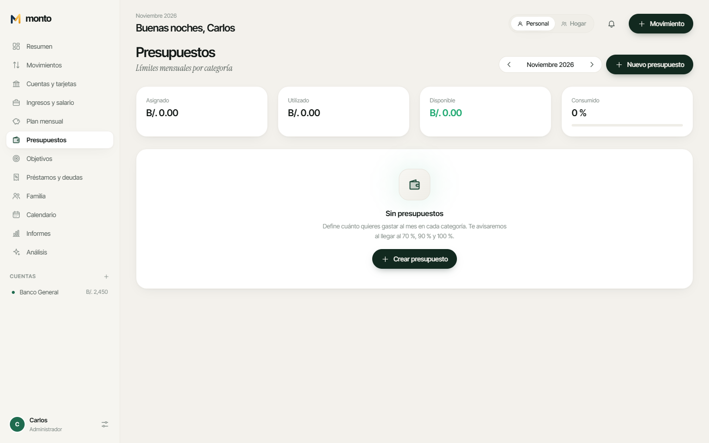 Presupuestos con alertas | 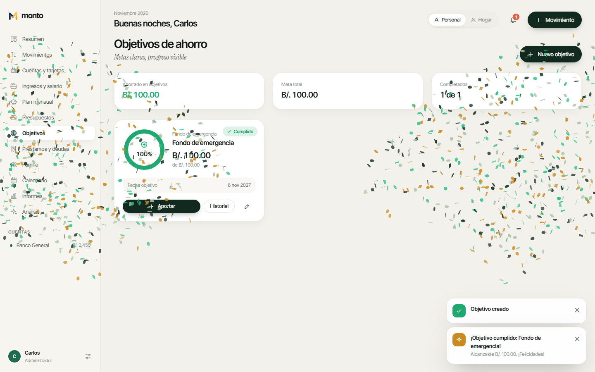 Objetivos de ahorro |
| 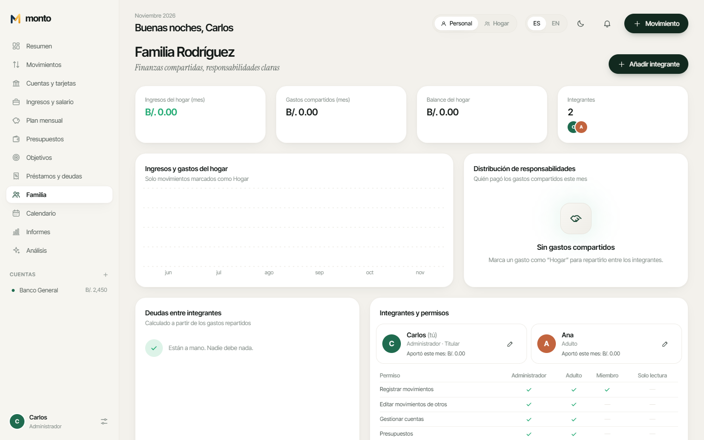 Finanzas familiares | 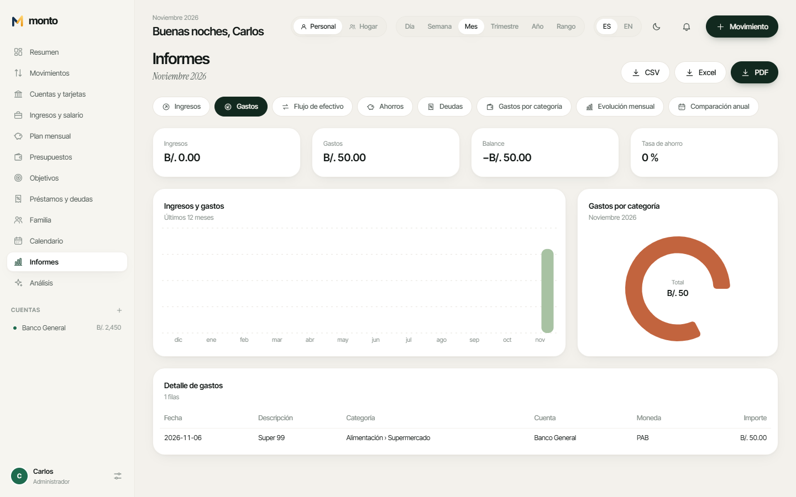 Informes exportables |
| 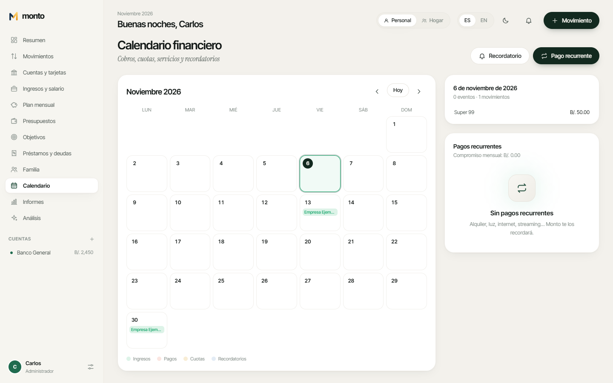 Calendario financiero | 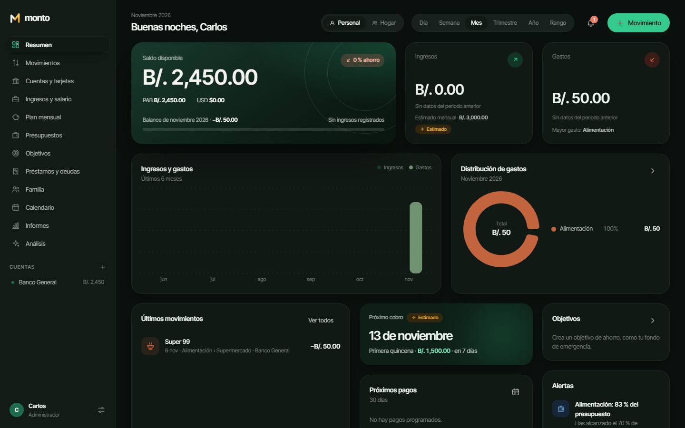 Modo oscuro |
| 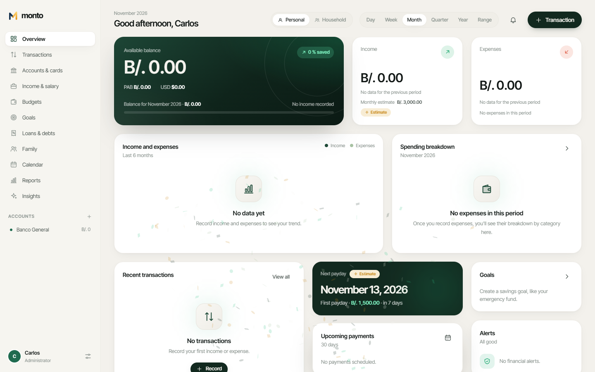 Interfaz en inglés | 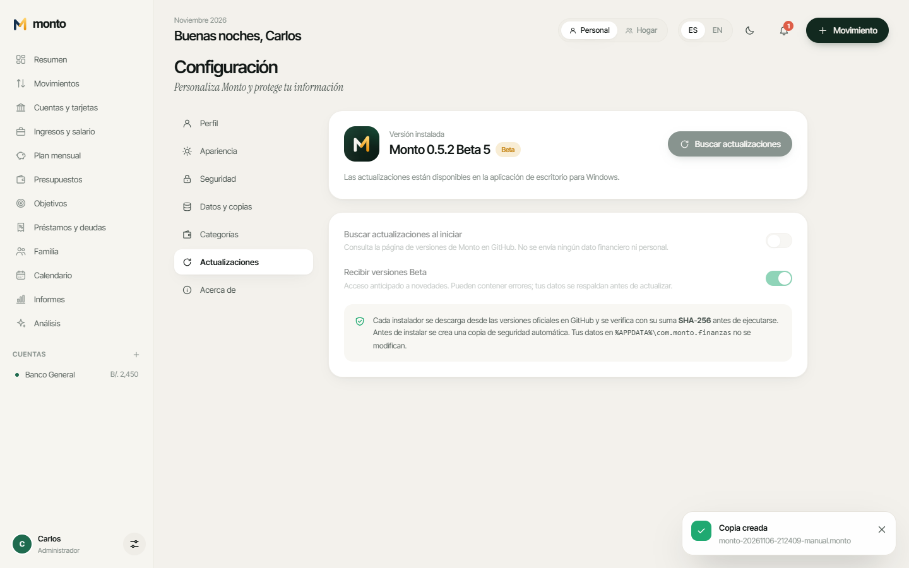 Actualizaciones integradas |

## Descargar

Las versiones estables se publican en **[GitHub Releases](https://github.com/eperez98/monto/releases)**:

- `Monto_x.y.z_x64.zip` — descomprímelo y ejecuta `Monto_x.y.z_x64-setup.exe` (Windows 10/11, español o inglés, no requiere administrador). Incluye `SHA256SUMS.txt` para verificar el instalador y `LEEME.txt`.

El instalador crea accesos directos en el menú Inicio y el escritorio, registra el desinstalador en *Configuración → Aplicaciones* y **conserva tus datos al actualizar**. Consulta la [guía de instalación](docs/instalacion.md).

## Tecnologías

| Capa | Tecnología | Motivo |
|---|---|---|
| Escritorio | [Tauri 2](https://tauri.app) (Rust + WebView2) | Instalador NSIS ligero, permisos explícitos |
| Interfaz | React 18, TypeScript estricto, Vite 7 | Componentes tipados y build rápido |
| Estilos | Tailwind CSS 4 con tokens de diseño propios | Tema claro/oscuro consistente |
| Animaciones | Motion (Framer Motion) | Transiciones fluidas con soporte de *reduced motion* |
| Gráficos | Recharts | Gráficos interactivos y animados |
| Base de datos | SQLite (sql.js / WebAssembly) | Archivo SQLite local, sin servidor |
| Validación | Zod | Validación en formularios y en la capa de datos |
| Estado | Zustand | Estado global mínimo |
| Exportación | ExcelJS, jsPDF + AutoTable | XLSX y PDF generados localmente |
| Calidad | Vitest, Playwright, ESLint, GitHub Actions | Pruebas unitarias, de integración y E2E |

Detalles en [docs/arquitectura.md](docs/arquitectura.md) y [decisiones de arquitectura](docs/decisiones/).

## Requisitos

**Para usar la aplicación:** Windows 10 (1803+) u 11 de 64 bits. WebView2 viene preinstalado en Windows 11; el instalador lo instala si falta.

**Para desarrollar:**
- Node.js 20 o superior (recomendado 22) y npm.
- Rust estable (`rustup`) — solo para compilar la app de escritorio.
- Windows: *Microsoft C++ Build Tools* y WebView2. Linux: `libwebkit2gtk-4.1-dev`, `libgtk-3-dev`, `librsvg2-dev` ([prerrequisitos de Tauri](https://tauri.app/start/prerequisites/)).

## Instalación para desarrollo

```bash
git clone https://github.com/eperez98/monto.git monto
cd monto
npm ci
npm run dev          # interfaz en el navegador: http://127.0.0.1:1420 (datos en IndexedDB)
npm run tauri dev    # aplicación de escritorio con recarga en caliente
```

## Configuración

Monto no necesita archivos `.env`, claves ni servicios externos.

| Elemento | Ubicación |
|---|---|
| Base de datos | `%APPDATA%\com.monto.finanzas\monto.db` |
| Copias automáticas | `%APPDATA%\com.monto.finanzas\backups\*.monto` |
| Ventana, permisos y CSP | `src-tauri/tauri.conf.json`, `src-tauri/capabilities/default.json` |
| Tema, animaciones, bloqueo | Dentro de la app: *Configuración* |

## Compilación

```bash
npm run lint && npm run typecheck && npm test   # calidad
npm run build                                   # frontend de producción (dist/)
npm run tauri build                             # instalador en src-tauri/target/release/bundle/nsis
npm run icons                                   # regenerar logotipos PNG e iconos de Windows desde los SVG
```

El instalador de Windows debe generarse en Windows. El flujo [`CI`](.github/workflows/ci.yml) lo compila en `windows-latest`, lo **instala en silencio, ejecuta la app, verifica que cree su base de datos SQLite, la desinstala y comprueba que los datos del usuario se conservan**.

## Guía de uso

1. **Primer inicio:** el asistente pregunta tu nombre, si usarás Monto de forma individual, en pareja o en familia, la moneda principal, cómo cobras (con cálculo en vivo del ingreso mensual y anual), tu cuenta principal y si quieres una contraseña.
2. **Registra movimientos** con el botón *Movimiento* o `Ctrl + N`.
3. **Confirma tus cobros** en *Ingresos y salario* cuando el dinero llegue a tu cuenta.
4. **Planifica** con presupuestos, objetivos y pagos recurrentes en el calendario.
5. **Hogar:** cambia a la vista *Hogar* para gastos compartidos; repártelos entre integrantes y salda deudas en *Familia*.
6. **Exporta** informes desde *Informes* y crea copias en *Configuración → Datos y copias*.

Manual completo: [docs/manual-de-usuario.md](docs/manual-de-usuario.md).

## Pruebas

```bash
npm test                         # 50 pruebas: cálculos, SQLite real, cifrado, permisos, persistencia, traducciones
npm run i18n:check               # lista los textos sin traducción al inglés
npm run dev & npm run e2e        # recorrido E2E en Chromium (onboarding, CRUD, exportación, persistencia, permisos)
node scripts/e2e.mjs --shots     # además regenera las capturas de assets/screenshots
```

## Estructura del proyecto

```
├── src/
│   ├── domain/        # Lógica pura: salarios, amortización, presupuestos, permisos, recurrencias, análisis
│   ├── db/            # Motor SQLite, migraciones, cifrado, adaptadores de almacenamiento y repositorios
│   ├── features/      # Módulos: dashboard, movimientos, cuentas, ingresos, presupuestos, objetivos, deudas…
│   ├── components/    # UI kit, layout y gráficos
│   ├── icons/         # Sistema de iconos propio
│   ├── lib/           # Dinero, fechas, versión e idiomas (i18n.ts, locales/en.ts)
│   └── services/      # Exportación (CSV/XLSX/PDF), copias de seguridad, archivos
├── src-tauri/         # Shell de escritorio (Rust), permisos, iconos y configuración del instalador
├── assets/            # Logotipos, iconos y capturas
├── docs/              # Arquitectura, base de datos, manuales y decisiones
└── .github/workflows/ # CI y publicación de versiones
```

## Contribuir

Las contribuciones son bienvenidas. Lee [CONTRIBUTING.md](CONTRIBUTING.md) para el flujo de ramas, convenciones y requisitos de los Pull Requests, y [SECURITY.md](SECURITY.md) para reportar vulnerabilidades. Los cambios se registran en [CHANGELOG.md](CHANGELOG.md) siguiendo [Semantic Versioning](https://semver.org/lang/es/).

## Licencia

Distribuido bajo la licencia **MIT**. Consulta [LICENSE](LICENSE). © 2026 Erick Arturo Pérez Cazorla.

---

<div align="center"><sub>Monto · Hecho en Panamá 🇵🇦</sub></div>
