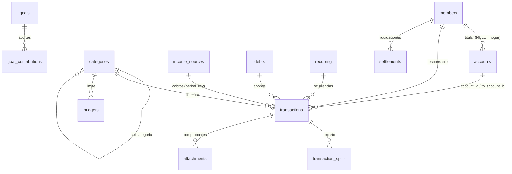

# Esquema de base de datos

SQLite 3 (sql.js). Versión del esquema en `PRAGMA user_version` (actual: **1**). Migraciones en `src/db/schema.ts`. Claves foráneas activadas (`PRAGMA foreign_keys = ON`).

**Convenciones:** importes en **céntimos** (`INTEGER`); fechas `TEXT` `YYYY-MM-DD`; marcas de tiempo ISO 8601; identificadores UUID v4 (`TEXT`); booleanos `INTEGER` 0/1; moneda `'PAB' | 'USD'`.

## Tablas

| Tabla | Propósito | Campos clave |
|---|---|---|
| `settings` | Perfil y preferencias (JSON) | `key` (`profile`, `preferences`), `value` |
| `members` | Integrantes y roles | `role` (`admin`/`adult`/`member`/`readonly`), `is_owner`, `pin_hash`, `active` |
| `accounts` | Cuentas y tarjetas | `type`, `currency`, `initial_balance`, `credit_limit`, `owner_member_id` |
| `categories` | Categorías (1 nivel de subcategorías) | `kind`, `parent_id`, `icon`, `color`, `is_system`, `archived` |
| `transactions` | Movimientos reales | `type`, `amount`, `currency`, `date`, `account_id`, `to_account_id`, `category_id`, `payment_method`, `member_id`, `scope`, `debt_id`, `income_source_id`, `period_key`, `recurring_id` |
| `transaction_splits` | Reparto de gastos del hogar | `transaction_id`, `member_id`, `amount` |
| `attachments` | Comprobantes (BLOB ≤ 5 MB) | `name`, `mime`, `size`, `data` |
| `income_sources` | Configuración de ingresos | `config` (JSON `IncomeConfig`), `currency`, `account_id`, `start_date` |
| `budgets` | Límite mensual por categoría | `category_id`, `amount`, `scope`, `member_id` (único por combinación) |
| `goals` / `goal_contributions` | Objetivos y aportes (+/−) | `target`, `target_date`, `completed_at` / `amount`, `date` |
| `debts` | Préstamos y deudas | `kind`, `direction` (`owe`/`owed`), `principal`, `annual_rate`, `term_months`, `payment_day` |
| `recurring` | Pagos/ingresos programados | `frequency`, `start_date`, `end_date`, `auto_post` |
| `reminders` | Recordatorios del calendario | `title`, `date`, `amount`, `done` |
| `settlements` | Liquidaciones entre integrantes | `from_member_id`, `to_member_id`, `amount` |
| `activity_log` | Historial (auditoría) | `member_id`, `action`, `entity`, `summary`, `scope` |
| `sessions` | Sesiones de uso | `member_id`, `started_at`, `ended_at`, `reason` |
| `dismissed_alerts` | Alertas descartadas | `key` |

## Reglas de saldo
`saldo = initial_balance + Σ(income, refund, loan_disbursement) − Σ(expense, loan_payment, transfer y card_payment de origen) + Σ(transfer y card_payment de destino)`.

- Las transferencias y los pagos de tarjeta **no** cuentan como gasto (el gasto se registró al usar la tarjeta).
- Total de gastos = `expense + loan_payment − refund`.
- Un movimiento debe usar la moneda de su cuenta; las transferencias entre PAB y USD se hacen a la par.

## Índices y restricciones
- `ix_tx_date`, `ix_tx_account`, `ix_tx_category`.
- `ux_tx_income_period (income_source_id, period_key)`: un cobro por periodo (evita duplicar quincenas).
- `ux_tx_recurring_date (recurring_id, date)`: una ocurrencia por fecha (registro automático idempotente).
- `CHECK` de importes positivos, tipos, monedas y ámbitos.

## Archivo
- Sin contraseña: archivo SQLite estándar.
- Con contraseña: `MONTOENC1` (9 B) + sal (16 B) + IV (12 B) + `AES-256-GCM(SQLite)`.
